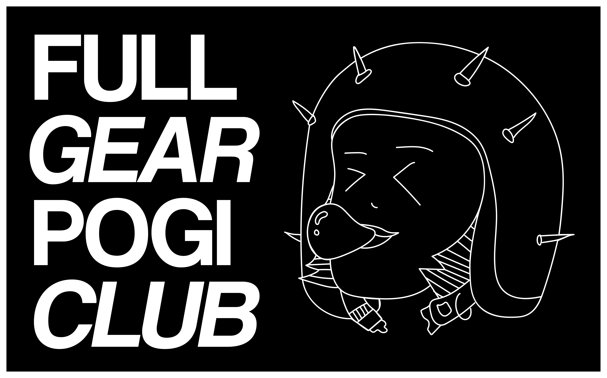
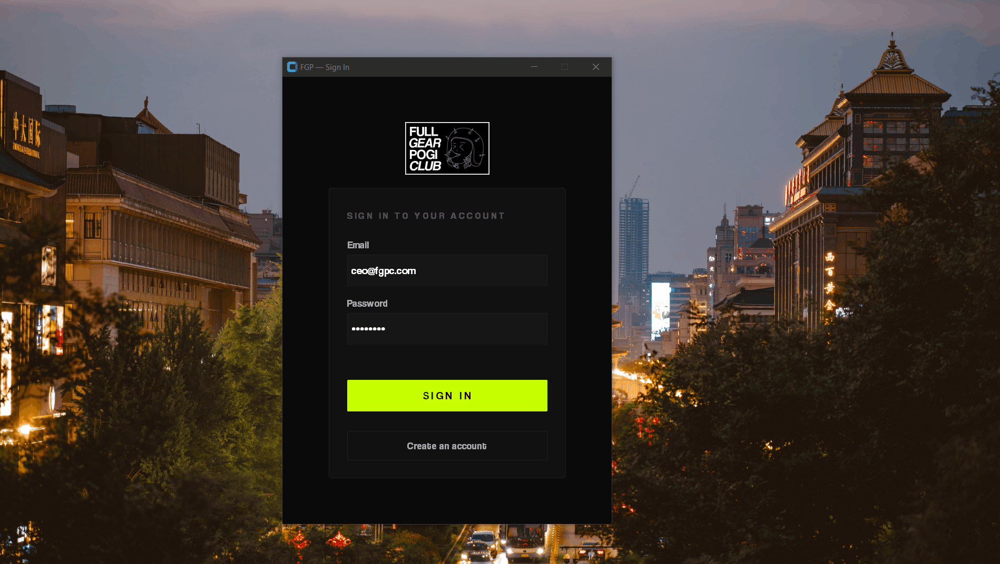

<!-- # Description -->

<p align="center">
  
  
</p>

<p align="center">
  
  
  
  
</p>

An e-commerce service application built with Python for a made-up motorcyle gear shop named the "Full Gear Pogi Club (FGPC)". I used py packages such as CustomTkinter (for UI) & Pillow (for Images). Also, SQLite for database. 

## Demo




## Technical Details

- **Language:** Python
- **User interface:** CustomTkinter desktop GUI with a reusable dark theme and responsive dashboard windows
- **Architecture:** I used an MVC architecture to make it organized.

The application starts in [`main.py`](main.py). On startup it applies the UI theme, initializes the SQLite schema, and opens the login window. The database path can be customized with the `DATABASE_PATH` environment variable; otherwise, the application uses `database/app.db`.

## Features

- Customer registration, login, profile management, service browsing, and appointment booking
- Admin dashboards for managing users, categories, services, and appointments
- Service and category image uploads stored under `uploads/`
- Appointment status workflow: pending, confirmed, completed, cancelled, and rejected
- Soft-delete support for users, services, categories, and appointments

## Project Structure

```text
main.py                 Application entry point
controllers/            Authentication, service, and appointment operations
models/                 SQLite-backed domain models
database/               Schema, database connection, seed, and migration helpers
views/                  Login, registration, customer, and admin interfaces
uploads/                Runtime-uploaded images (ignored by Git)
```

## Setup

1. Install Python 3.10 or later.
2. Install the runtime dependencies:

   ```bash
   pip install customtkinter pillow
   ```

3. Start the application:

   ```bash
   python main.py
   ```

The database tables are created automatically on first launch. Keep local database files and uploaded assets out of source control because they may contain application data or personal information.
